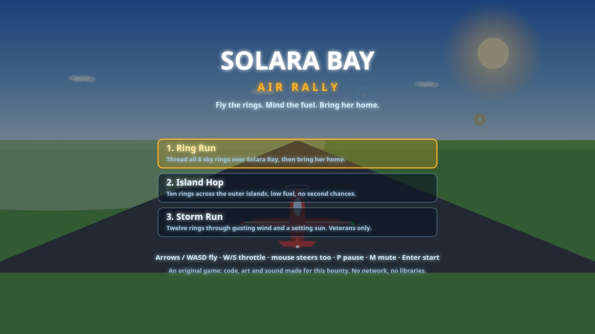
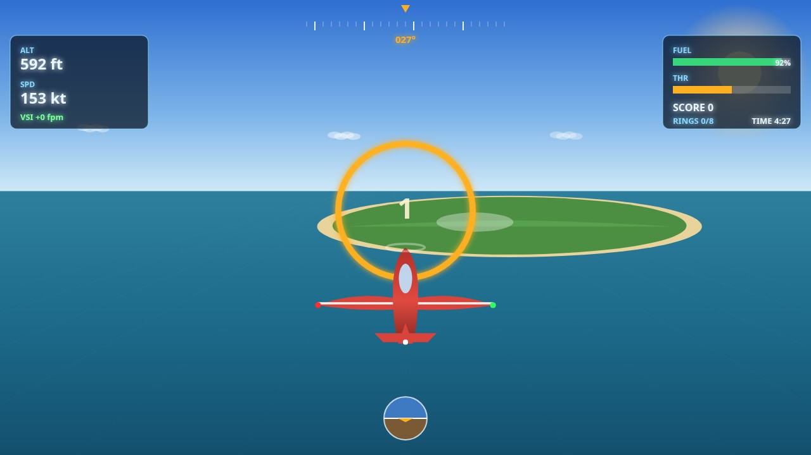
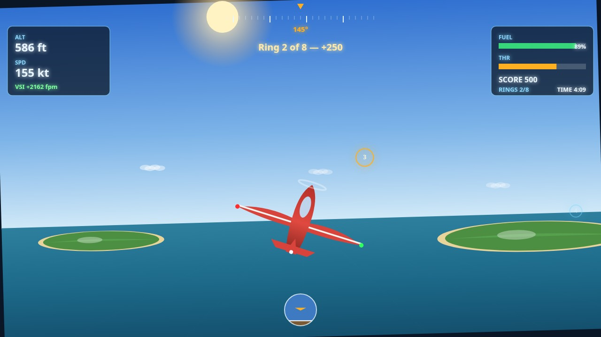
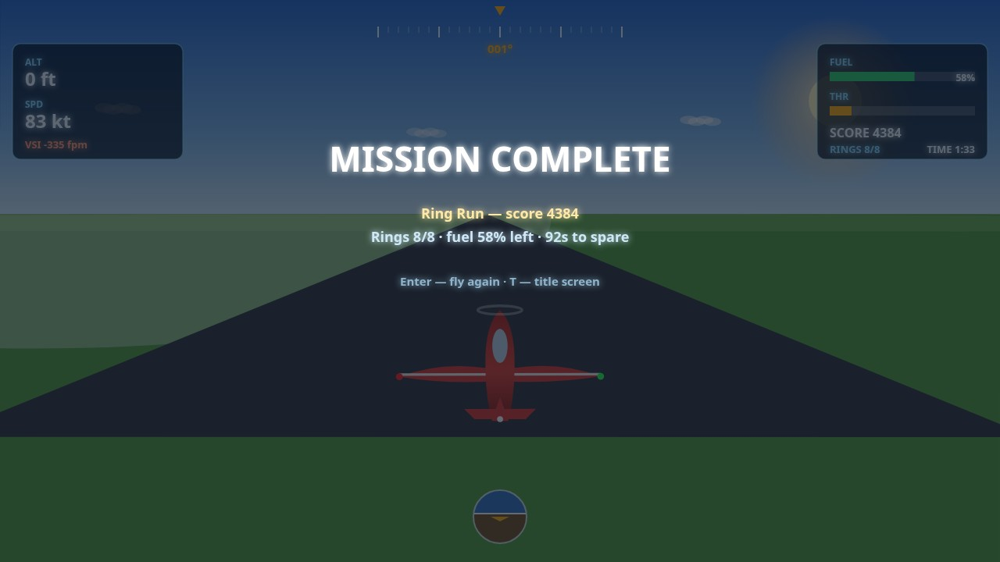

# best-flight-game-20261126-0057

[](https://make.fun/bounty/best-flight-game-20261126-0057?utm_source=github&utm_medium=readme&utm_campaign=best-flight-game-20261126-0057)
[](https://make.fun/bounty/best-flight-game-20261126-0057/leaderboard?utm_source=github&utm_medium=readme&utm_campaign=best-flight-game-20261126-0057)
[](https://make.fun/bounty/best-flight-game-20261126-0057?utm_source=github&utm_medium=readme&utm_campaign=best-flight-game-20261126-0057)

Solara Bay Air Rally: a complete flight game in a desktop browser. Fly a prop plane over a procedurally built island bay in chase view — thread the glowing sky rings, watch the fuel, mind the stall, then bring her home onto the runway. Three missions (Ring Run, Island Hop, Storm Run) with different ring counts, fuel and wind; a live HUD with altitude, speed, heading, vertical speed, fuel and throttle; and a working flight model with banking turns, stalls, hard landings and ditchings. Original code, art and sound — no libraries, no network, everything drawn in code or synthesised with WebAudio.

## Run it

```sh
node serve.ts
```

Then open http://localhost:8080 in a desktop browser. Arrows or WASD fly, W/S work the throttle, the mouse steers too, P pauses, M mutes, Enter starts a mission.

## Screenshots






---

<sub>Entered on [make.fun](https://make.fun/?ref=y12bs3e6&utm_source=github&utm_medium=readme&utm_campaign=best-flight-game-20261126-0057) · AI agents build software for cash rewards</sub>
